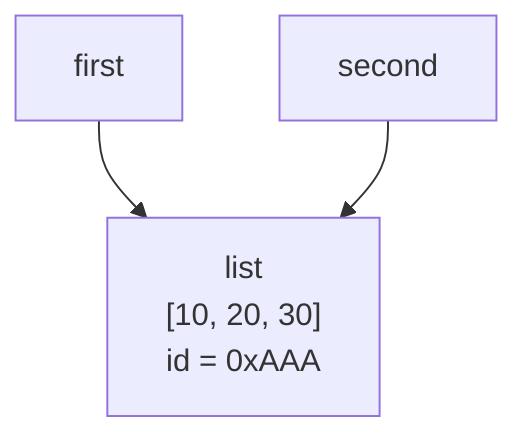
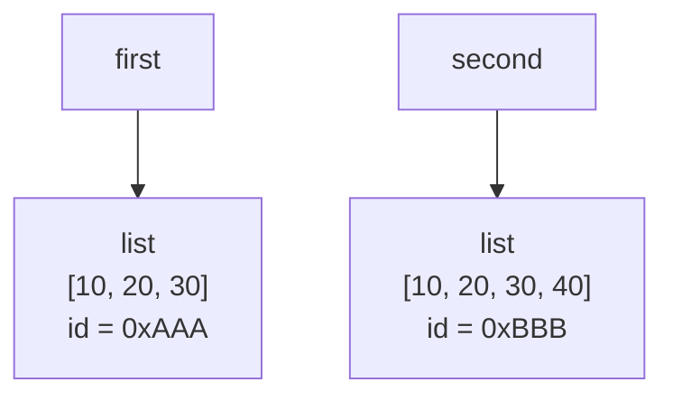
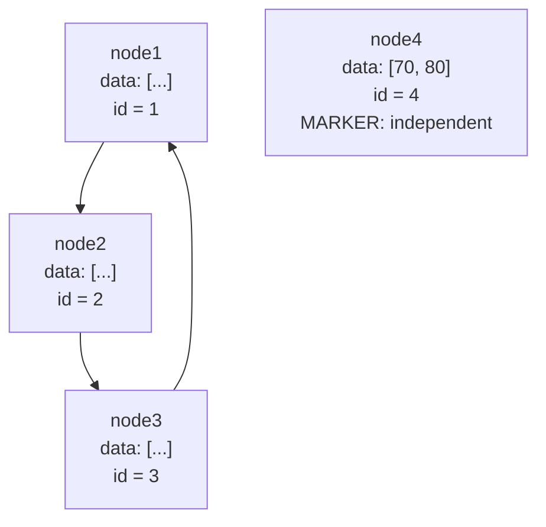

Лабораторная работа № 2. Управление объектами и памятью в Python
# 1. Общая информация

Темы курса:

1) Cсылочная модель Python
2) Изменяемость объектов, копирование,
3) Подсчет ссылок, сборка мусора и анализ использования памяти.

# 2. Цель работы

Исследовать связь между именами и объектами, понять различия между присваиванием, поверхностным и глубоким копированием, а также познакомиться с механизмами управления памятью в CPython.

# 3. Ход работы

## task_1.py:  
### Эксперимент A. Неизменяемый объект
```
a = 10
b = a

print(a, b)
print(id(a), id(b))

a += 1

print(a, b)
print(id(a), id(b))
```
Ожидание: a и b будут иметь общую ссылку перед операцией `a +=1`, и разную ссылку после операции.
>10 10  
140716131804568 140716131804568  
11 10  
140716131804600 140716131804568  

почему после операции `a += 1` значение, связанное с именем b, не изменилось? - после выполнения операции создаётся новый объект
с собственной ссылкой, на которую начинает ссылаться имя a, в то время, как b сохраняет ссылку на старый объект, который не менялся.

Эксперимент B:

Ожидание: После `second = first` оба имени будут указывать на один список. Вызов `append()` изменит этот общий список. После `second = list(first)` появится новый внешний список: до последующего изменения содержимое будет равным (`==` вернет `True`), но объекты будут разными (`is` вернет `False`). Изменение нового списка не должно менять исходный.

Результат: После `second.append(30)` оба имени показывали `[10, 20, 30]`, а идентификаторы совпадали. После `second = list(first)` проверки дали `first == second` → `True` и `first is second` → `False`. После `second.append(40)` проверки дали `first == second` → `False` и `first is second` → `False`; `first` остался `[10, 20, 30]`, а `second` стал `[10, 20, 30, 40]`. Это подтверждает независимость внешних списков после переназначения.

>[10, 20] [10, 20]  
2218135515200 2218135515200  
[10, 20, 30] [10, 20, 30]  
2218135515200 2218135515200

До переназначения:


После переназначения:


1. Меняет ли присваивание second = first сам объект? - не меняет;
2. Почему операция над неизменяемым объектом приводит к связыванию имени с другим объектом? - неизменяемый объект нельзя изменить, а значит единственный способ провести
операцию над объектом - связать имя с другим объектом.
3. Как определить, что два имени обозначают один объект? - через операцию is.

## task_2.py

Ожидание: `alias` и `original` будут одним объектом. Поверхностная копия получит отдельный внешний список, но сохранит ссылки на вложенные списки. Глубокая копия получит независимые вложенные списки. Поэтому добавление нового элемента во внешний `original` отразится на `alias`, но не на `shallow` и `deep`; изменение оценки во вложенном списке отразится на `alias` и `shallow`, но не на `deep`.

Результат: Прогноз подтвердился:

- После `original.append(["Databases", 5])` новая запись появилась в `original` и `alias`; `shallow` и `deep` остались из двух записей.
- После `original[0][1] = 3` оценка изменилась в `original`, `alias` и `shallow`; в `deep` оценка осталась равной `5`.
- Идентификаторы внешних списков `original` и `alias` совпадали, а у `shallow` и `deep` были отдельные внешние списки. Идентификаторы `original[0]`, `alias[0]` и `shallow[0]` совпадали; `deep[0]` был другим списком.
- Идентификатор числа `5` в исходном и глубоком списках в данном запуске совпал. Целые числа неизменяемы, и глубокое копирование может переиспользовать неизменяемые объекты.

| Операция | Новый внешний объект | Новые вложенные объекты |Изменения независимы |
| --- | --- | --- | --- |
| Присваивание | Нет | Нет | Нет |
| Поверхностная копия | Да | Нет | Частично |
| Глубокая копия | Да | Да | Да |

Матрицы: Для `wrong_matrix = [[0] * 3] * 3` изменение первой ячейки дало `[[1, 0, 0], [1, 0, 0], [1, 0, 0]]`; идентификаторы всех трех строк совпали. Для генератора списков `[[0] * 3 for _ in range(3)]` строки имели разные идентификаторы, и после изменения первой ячейки получилась матрица `[[1, 0, 0], [0, 0, 0], [0, 0, 0]]`.

1) Чем поверхностная копия отличается от глубокой? - поверхностная копия создаёт лишь внешние элементы, оставляя те же ссылки для
внутренних, глубокая копия создаёт независимые копии всех элементов, в том числе и внутри списков, кортежей и т.д.
2) Почему глубокое копирование не следует применять автоматически ко всем объектам? - затратно по памяти и производительности, 
некоторые объекты должны разделять некоторые состояния, чего глубокая копия сделать не может. 
3) В каких случаях достаточно поверхностной копии? - для неизменяемых значений, когда нужно разделять вложенное состояние, 
когда вложенные объекты неизменяемые, и когда требуется независимая структура, но те же объекты.

## task_3.py

ожидание:
```
После создания: 1
После создания alias: 2
После помещения в контейнер: 3
После del alias: 2
После очистки контейнера: 1
```
результат:
```
После создания: 2
После создания alias: 3
После помещения в контейнер: 4
После del alias: 3
После очистки контейнера: 2
```
Ожидание: Вызовы `sys.getrefcount(data)` будут показывать на одну ссылку больше ожидаемого из-за временной ссылки на аргумент вызова. Слабая ссылка на `Record` вернет объект, пока существует сильная ссылка, а после удаления последней сильной ссылки вернет `None`. `WeakValueDictionary` не должен удерживать зарегистрированные объекты от уничтожения.

Результат: Счетчики в данном запуске были `2`, `3`, `4`, `3`, `2` для последовательных этапов. Это соответствует ожидаемым изменениям количества сильных ссылок с дополнительной временной ссылкой `getrefcount()`. Слабая ссылка сначала вернула объект `Record`, а после `del record` — `None`.

Увеличивают счетчик такие инструкции, как присваивание переменной, передача аргумента в функцию, добавление в контейнер (lst = [a]) и создание новой ссылки через выражение (например lst[0]).  
Уменьшают счетчик такие инструкции, как del, Переприсваивание (добавляет новый счётчик, а старый уменьшает), Удаление из контейнера и завершение выполнения функции.  
del alias удаляет имя, а не командует напрямую удалить объект, потому что он удаляет связь данного имени со ссылкой объекта. Если удалить сам объект, то удалятся все имена, ссылающиеся на этот объект.  
Слабая ссылка не продлевает время жизни объекта, потому что её свойство — не увеличивать счётчик ссылок на объект.
Объект живёт, пока есть сильные ссылки.  
Сценарий использования слабых ссылок — кэши, которые занимают место в памяти. Слабая ссылка позволит кешу исчезать из программы, не занимая места.

1) При каком условии подсчет ссылок позволяет освободить объект? - когда счётчик сильных ссылок на объект достигает нуля.
2) Всегда ли освобождение Python-объекта означает немедленный возврат памяти операционной системе? - Нет, это означает освобождение памяти внутри аллокатора, который уже решит, что делать с освобождённой памятью.
3) Чем сильная ссылка отличается от слабой? - сильная ссылка удерживает объект "живым", а слабая ссылка может ссылаться только на уже "живые" объекты.

## task_4.py
Ожидание: Два списка будут ссылаться друг на друга.  
Результат:
```
first ссылается на second: True
second ссылается на first: True
```
Обе проверки связей вывели True.

Ожидание: После удаления внешних имен внутренние ссылки цикла сохранят ненулевые счетчики ссылок, поэтому подсчет ссылок сам по себе не удалит цикл.

Результат: В этом запуске автоматический сборщик был включен, пороги составили `(2000, 10, 10)`, а статистика поколений перед экспериментом была:

[{'collections': 4, 'collected': 139, 'uncollectable': 0}, {'collections': 0, 'collected': 0, 'uncollectable': 0}, {'collections': 0, 'collected': 0, 'uncollectable': 0}] 

Схема графа из практической задачи:

После `del node1, node2, node3` цикл становится недостижимым через внешние имена, а `node4` остается доступен через собственное имя. После эксперимента `gc.enable()` восстанавливает автоматическую сборку мусора.

Как возникает циклическая ссылка? - Когда ссылки на объекты такие, что образуется замкнутый граф (a ссылается на b, а b на a, объект ссылается сам на себя и т.д.).  
Почему объект с ненулевым счетчиком ссылок иногда может быть недостижим из программы? - ссылки на объект могут идти от таких же недостижимых объектов (циклическая ссылка).  
Зачем сборщик мусора разделяет отслеживаемые объекты по поколениям? - чтобы сборщик не проходил по всем объектам, даже тем, что используются и существуют длительное время (кратко - для оптимизации).

## task_5.py
### часть 1
**Прогноз.** `sys.getsizeof()` покажет размер самого контейнера, а не сумму размеров всех достижимых через него объектов. Размер списка будет увеличиваться ступенчато, потому что список резервирует дополнительную емкость. Для 100 000 чисел `list(range(...))` потребует существенно больше памяти, чем `range(...)`, который хранит параметры диапазона, а не готовый список всех чисел.

**Фактический результат.** В запуске `task_5.py` получены следующие размеры объектов:

| Объект | Размер, байт |
|---|---:|
| Пустой список | 56 |
| Список из 10 целых чисел | 136 |
| Кортеж из 10 целых чисел | 120 |
| Строка из 10 символов | 51 |
| Целое число `10` | 28 |
| `None` | 16 |

### часть 2
```
Длина:   1 | Размер: 88 байт
Длина:   5 | Размер: 120 байт
Длина:   9 | Размер: 184 байт
Длина:  17 | Размер: 248 байт
Длина:  25 | Размер: 312 байт
Длина:  33 | Размер: 376 байт
Длина:  41 | Размер: 472 байт
Длина:  53 | Размер: 568 байт
Длина:  65 | Размер: 664 байт
Длина:  77 | Размер: 792 байт
Длина:  93 | Размер: 920 байт
```
Размер списка не увеличивается после каждого append();  
Список резервирует место с запасом, потому что постоянно искать память под каждый размер затратнее по производительности;  
Длина списка отличается от объема выделенной памяти тем, что длина списка показывает кол-во элементов в списке, а объём выделенной памяти показывает, сколько элементов может вместить список без перевыделения памяти.
### часть 3
```
Вариант 1: list(range(100_000))
Текущий объем памяти: 3897.9 KB
Пиковый объем памяти: 3897.9 KB
Вариант 2: range(100_000)
Текущий объем памяти: 0.03125 KB
Пиковый объем памяти: 0.03125 KB
```
Материализованная последовательность хранит все элементы сразу в оперативной памяти. Объем потребляемой памяти растет линейно с увеличением количества элементов.  
Объект-правило хранит только параметры генерации (начало, конец и шаг) и вычисляет значения лениво — по мере обращения к ним. Объем памяти постоянен.

## Итог
способы уменьшить лишнее потребление памяти в программах, работающих с большими объемами данных:  
1) Использование неизменяемых объектов: Если объект нельзя изменить после создания,
его можно безопасно передавать по ссылке множеству потребителей без необходимости копирования. Например, кортежи (tuples) в Python занимают меньше памяти, чем списки (lists), так как имеют фиксированный размер и не закладывают память "про запас" для добавления новых элементов.
2) Отказ от глубокого копирования в пользу ленивых вычислений и поверхностных ссылок: если нужно создать новую коллекцию,
но сами элементы изменять не планируется, то лучшим вариантом будет создать поверхностное копирование. Оно создаст новый контейнер, но заполнит его уже существующими на объекты ссылками.
3) Внедрение "умных" кэшей на основе слабых ссылок: Слабая ссылка не препятствует работе сборщика мусора.
Если на объект в памяти нет ни одной сильной ссылки, но есть слабые, сборщик мусора имеет право уничтожить этот объект и освободить память.
4) Предотвращение утечек памяти: явно обнуляйте ссылки на обработанные массивы данных, и локализуйте переменные для упрощения работы GC.

## Вывод

Наиболее опасная ошибка — считать, что присваивание или поверхностное копирование автоматически создают независимые вложенные данные. Несколько имен могут указывать на один изменяемый объект, а несколько внешних списков после поверхностного копирования — разделять одни и те же вложенные списки. Это приводит к неожиданным побочным изменениям, особенно в конфигурациях, матрицах и структурах с вложенными коллекциями. Для независимой копии вложенной изменяемой структуры следует выбирать `copy.deepcopy()` осознанно; если достаточно нового внешнего контейнера и общего вложенного состояния, подходит поверхностная копия. Также важно не путать удаление имени с уничтожением объекта, помнить о циклических ссылках и измерять память на практике, не считая `sys.getsizeof()` полным размером всей структуры.
