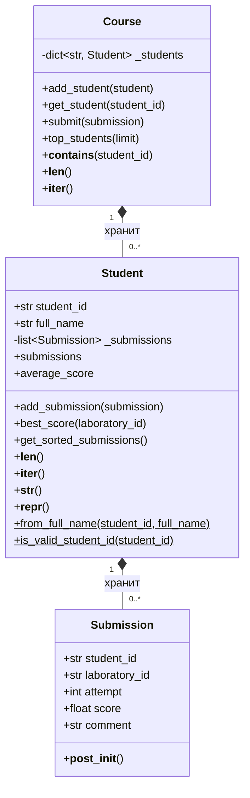
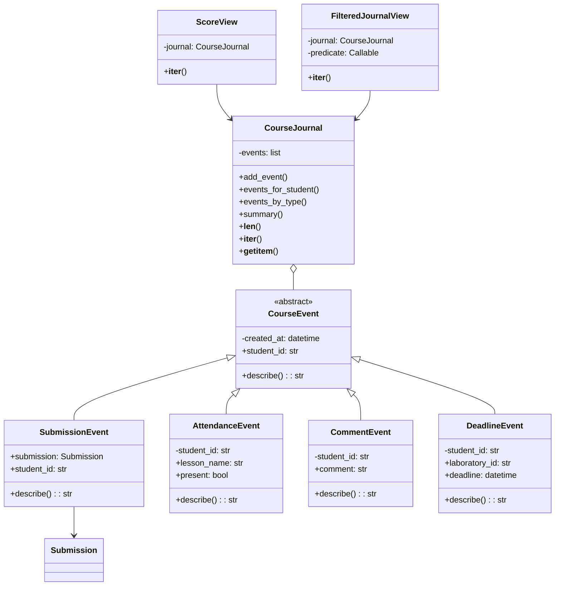

# Лабораторная работа № 4. Итераторы, генераторы и объектная модель Python
 
# 1. Общая информация  
  
Темы курса:  
  
1. Управление потоком выполнения,  
2. Базовые алгоритмы, коллекции,  
3. Хеширование, функции и области видимости.  
  
  
# 2. Цель работы  
  
Научиться переводить условие задачи в алгоритм, выбирать подходящую структуру данных и разделять программу на небольшие функции с понятными контрактами.  
  
# 3. Ход работы  
  
## task_1.py:    
  
StopIteration

Сравните повторный обход списка и повторный обход его итератора. Объясните, почему результаты отличаются. - Список хранит свои элементы и позволяет начинать обход заново при каждом вызове `iter()`; Итератор хранит своё текущее состояние, а после получения всех элементов он становится исчерпанным и самостоятельно не возвращается к началу.
- Что должен возвращать `iter()` для итерируемого объекта? - `iter()` возвращает итератор, по которому можно проходить через `next()`, сохраняя состояние обхода.
- Что должен делать `next()` после исчерпания данных? - следующий вызов `next()` должен возбуждать исключение `StopIteration` для остановки циклов.
- Почему итератор обычно возвращает себя при вызове `iter(iterator)`? - итератор уже представляет собой объект для последовательного обхода элементов, то есть, итератор.
## task_2.py  

Были созданы два независимых итератора одного объекта StepRange. При последовательном вызове next() каждый итератор независимо выдавал элементы диапазона. Изменение состояния одного итератора не влияло на состояние другого. Это достигается благодаря созданию нового объекта StepRangeIterator при каждом вызове **iter**().

| Действие  | Полученное значение | A.current | B.current |
| :-------- | :-----------------: | :-------: | :-------: |
| Начало    |          —          |     2     |     2     |
| `next(A)` |          2          |     5     |     2     |
| `next(B)` |          2          |     5     |     5     |
| `next(A)` |          5          |     8     |     5     |
| `next(B)` |          5          |     8     |     8     |
| `next(A)` |          8          |    11     |     8     |
| `next(B)` |          8          |    11     |    11     |

| Способ поиска            | Сложность | Что происходит                     |
| :----------------------- | :-------- | :--------------------------------- |
| `__contains__()`         | O(1)      | Вычисления по параметрам диапазона |
| Последовательный перебор | O(n)      | Проверка элементов по одному       |
Собственный метод **contains**() работает за постоянное время O(1), поскольку проверяет принадлежность элемента с помощью арифметических операций. Последовательный перебор имеет сложность O(n), так как в худшем случае необходимо проверить все элементы диапазона.
1. **Почему состояние обхода лучше хранить в отдельном объекте?** - Состояние обхода лучше хранить в отдельном объекте-итераторе, чтобы каждый обход имел независимое состояние.
2. **Что произойдёт, если** `__iter__()` **всегда будет возвращать один и тот же изменяемый итератор?** - все попытки обхода будут использовать один объект.
3. **Сколько памяти относительно числа элементов требует** `StepRange`**?** - StepRange требует O(1) дополнительной памяти относительно количества элементов последовательности.
## task_3.py  

### Реализация генераторов

Были реализованы следующие генераторы:

- `read_measurements()` — преобразует непустые строки в вещественные числа;
- `filter_range()` — пропускает значения из заданного диапазона;
- `moving_average()` — вычисляет скользящее среднее;
- `take()` — возвращает первые n элементов;
- `drop()` — пропускает первые n элементов;
- `batch()` — разбивает последовательность на пакеты заданного размера.

Промежуточные последовательности не преобразуются в списки.
Данные передаются между этапами конвейера лениво, по мере запроса.

В ходе эксперимента установлено:

- Генератор является одноразовым итератором.
- После исчерпания повторный обход не возвращает предыдущие значения.
- Для повторной обработки необходимо создать новый генератор.
- Использование генератора не изменяет исходный список, если функция явно его не изменяет.

### Включения и генераторные выражения

Были созданы:

- список квадратов чётных чисел от 1 до 20;
- множество длин непустых строк;
- словарь чисел и их квадратов от 1 до 10;
- генераторное выражение для вычисления суммы квадратов миллиона чисел.

Включения создают готовые коллекции в памяти.
Генераторные выражения вычисляют значения по мере получения.
Поэтому генераторные выражения обычно требуют меньше памяти,
когда не требуется хранить все результаты одновременно.

###  Сравнение использования памяти

Для измерения пиковой памяти использовался модуль `tracemalloc`.

Количество исходных элементов: 100 000.

| Вариант              | Пиковая память |
| -------------------- | -------------: |
| Ленивый конвейер     | 2.685546875 КБ |
| Конвейер со списками |  4771.59375 КБ |

Память ленивого конвейера: 1229880.0.

Память конвейера со списками: 1229880.0.

Результаты совпадают: True.

Ленивый конвейер не сохраняет все промежуточные результаты.
Он обрабатывает элементы последовательно и хранит только
необходимое состояние, в том числе текущее окно скользящего среднего.

Вариант со списками создаёт отдельные коллекции на каждом этапе, поэтому промежуточные данные занимают дополнительную память.
  
## task_4.py  
  



**Где используется композиция?**

В программе есть две связи:

**Course и Student*:

`Course` хранит зарегистрированных студентов в словаре `_students`, Каждый студент доступен по своему идентификатору.

**Student и Submission**:

Объект `Student` хранит список своих работ `_submissions`. Каждая работа содержит информацию об одной попытке сдачи лабораторной.
`Course` управляет студентами, а `Student` управляет своими работами.


**Почему наследование между `Student` и `Submission` было бы некорректным?**

Если бы `Student` наследовался от `Submission`, это означало бы, что студент является попыткой сдачи лабораторной работы:

- `Student` — человек, который учится на курсе.
    
- `Submission` — запись об одной попытке сдачи работы.
    

Поэтому между ними правильно использовать композицию, а не наследование.


**Какие инварианты защищает каждый класс?**

| Класс        | Защищаемые правила                                                                                                   |
| ------------ | -------------------------------------------------------------------------------------------------------------------- |
| `Submission` | Идентификаторы непустые, попытка положительная, оценка от 0 до 100                                                   |
| `Student`    | ID и имя непустые, студент не может добавить чужую работу                                                            |
| `Course`     | Один студент не может быть зарегистрирован дважды, сдавать работу через курс может только зарегистрированный студент |

Также свойство `submissions` возвращает кортеж, поэтому внешний код не может добавлять и удалять элементы внутреннего списка через это свойство.

**Примеры работы стандартных функций `len()`, `iter()` и оператора `in` с созданными объектами:**
```
#len
print(len(course))   # количество зарегистрированных студентов
print(len(student))  # количество попыток сдачи

#iter
student_iterator = iter(student)
course_iterator = iter(course)

print(next(student_iterator))
print(next(course_iterator))
#in
print("ST001" in course)
print("ST999" in course)
```

## task_5.py

### Результаты демонстрационного сценария

В демонстрационном сценарии созданы три студента и десять событий:
- четыре события сдачи лабораторных работ;
- три события посещения занятий;
- три события с комментариями.

Для студента `ST001` зарегистрированы две попытки сдачи лабораторной работы `LAB04`: первая с результатом 75 баллов, вторая — 95 баллов.

Проверена работа следующих возможностей:

1. Добавление событий в журнал и получение количества событий через `len()`.
2. Обход журнала с помощью цикла `for`.
3. Получение событий по индексу и срезу.
4. Фильтрация событий по идентификатору студента и типу события.
5. Формирование временной шкалы с помощью `render_timeline()`.
6. Получение статистики через `summary()`.
7. Ленивый обход оценок с помощью `ScoreView`.
8. Повторный обход `ScoreView` и `FilteredJournalView`.

`ScoreView` возвращает результаты сдач:

`[75.0, 95.0, 82.0, 91.0]`

Среднее значение составляет 85.75 балла.

Дополнительно создан класс `DeadlineEvent`. Новое событие добавлено в журнал и успешно обработано функцией `render_timeline()` без изменения её реализации.

Класс `FilteredJournalView` позволяет лениво получать события, удовлетворяющие заданному условию. Проверена фильтрация по типу события и по идентификатору студента, в том числе с использованием `lambda`. Повторный обход представления возвращает те же подходящие события, если журнал и условие фильтрации не изменились.

### Вывод по заданию 5

В ходе задания реализован расширяемый журнал учебных событий. Наследование позволило создать общую иерархию событий, композиция — объединить объекты в единую систему, а протоколы Python — обеспечить совместимость пользовательских классов со стандартными операциями языка.

Генераторы и ленивые представления позволили получать данные по мере необходимости, не создавая промежуточные списки.

### Наследование, композиция и протоколы

**Наследование**

Наследование используется для создания иерархии событий. 
Абстрактный класс `CourseEvent` определяет общий интерфейс: свойство 
`student_id`, метод `describe()` и время создания события.

Классы `SubmissionEvent`, `AttendanceEvent`, `CommentEvent` и 
`DeadlineEvent` наследуются от `CourseEvent` и реализуют собственный 
метод `describe()`.

Это позволяет добавлять новые типы событий с общей структурой.

**Композиция**

Композиция используется в классе `CourseJournal`, который хранит 
список объектов `CourseEvent`.

Также `ScoreView` и `FilteredJournalView` получают объект `CourseJournal`
и используют его для получения событий.

`SubmissionEvent` содержит объект `Submission`, поэтому событие сдачи
работы использует данные уже существующей модели.

**Протоколы Python**

Классы `CourseJournal`, `ScoreView` и `FilteredJournalView` поддерживают 
протокол итерации благодаря методу `__iter__()`. Это позволяет использовать их в цикле `for` и передавать стандартным функциям, работающим с итерируемыми объектами.

Класс `CourseJournal` дополнительно реализует `__len__()` и 
`__getitem__()`, благодаря чему поддерживает `len()`, индексацию 
и срезы.

**Вывод**

Наследование позволяет создавать разные виды событий с общим интерфейсом.
Композиция позволяет объединять объекты, не создавая между ними 
отношений наследования.
Протоколы Python обеспечивают совместимость пользовательских объектов 
со стандартными операциями языка.

# Вывод
